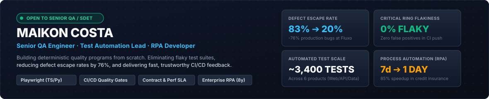

<!-- ========================================================================
     HERO: THE LEADER CARD & PLAYMAT (TCG / EUROGAME CONCEPT)
     ======================================================================== -->
<div align="center">

  

  <p align="center">
    <a href="https://maikonfcosta.github.io/portfolio/" target="_blank">
      
    </a>
    <a href="https://www.linkedin.com/in/maikonfcosta/" target="_blank">
      
    </a>
    <a href="mailto:maikonfcosta@gmail.com">
      
    </a>
    
    
  </p>

</div>

---

### ⚡ Game Stats & Impact at a Glance

<div align="center">

| **~3,400** | **83% ➔ 20%** | **0% Flakiness** | **7 Days ➔ 1 Day** |
| :---: | :---: | :---: | :---: |
| **Active Tests in CI**<br><sub>Playwright, Vitest & xUnit across 6 products (Fluxo)</sub> | **Production Escape Rate**<br><sub>Defect drop achieved across four 2-week sprints</sub> | **Critical Ring Instability**<br><sub>Deterministic execution over consecutive builds</sub> | **Credit-Life RPA Bot**<br><sub>Consolidation speedup via Automation Anywhere & Python</sub> |

</div>

---

## 📜 The Rulebook · How I Play the Quality Game

In complex Eurogames (*Gloomhaven*, *Caverna*, *7 Wonders Duel*) and production systems, winning is never about lucky dice rolls: it's about knowing the rules inside out, isolating variables, and making sure the pipeline never breaks when you push to production.

I started out in **2018 with RPA**, solving messy operational workflows with deterministic bots. When I moved into **Quality Engineering (QA / SDET)**, I brought the exact same obsession: not just checking if a test turns green, but understanding exactly why systems fail and building safety nets so developers can deploy on Friday without anxiety.

- 🛡️ **Quality Engineering (Senior QA / SDET):** Built the QA foundation from scratch at Fluxo (foreign exchange fintech) across 6 products (.NET 8, Next.js, Python services, AI copilots). Reduced manual runs to **3.5% of test executions**, locked flaky rates to **0% in critical rings**, and bridged Datadog Error Tracking directly with Azure DevOps.
- ⚙️ **Process Automation (RPA Developer):** Built bots at BRQ Digital Solutions, Unimed Porto Alegre, and Bosch Service Solutions (8-year journey) using Automation Anywhere (A360 Certified), UiPath, Power Automate, and Python.
- 🤖 **AI-Assisted CI Diagnostics:** Experimenting with LLM agents that read error logs, PR diffs, and codebase context to classify failures (product bug vs infra hiccup vs test drift) with confidence scores.

<details>
<summary><b>📋 View Player Sheet · Quick Bio (Click to open)</b></summary>
<br>

| Trait | Details |
| :--- | :--- |
| **Player Name** | Maikon Felipe Fernandes da Costa |
| **Class & Archetype** | Senior QA Engineer · RPA Developer · SDET |
| **Education** | CST in Systems Analysis & Development (USF) · B.S. in Business Administration |
| **Base Coordinates** | Valinhos, São Paulo · Brazil (UTC-3) |
| **Languages** | Portuguese (Native) · English (Professional Working / B2) |
| **Special Moves** | Zero-flakiness test rings, contract drift scanning, load & SLO testing, enterprise RPA |

</details>

---

## 🃏 The Open Source Deck · Featured Projects

All projects below are fully open source, running on live CI/CD, and backed by reproducible code.

| Project | Focus & Core Stack | The Move (What it Does) | Live Deliverables |
| :--- | :--- | :--- | :--- |
| **[Playwright Reference Suite](https://github.com/maikonfcosta/playwright-reference-suite)** | `TypeScript` `Playwright` `Docker` | RealWorld/Conduit suite with per-test data isolation and direct API auth. Runs 17 critical tests in ~10s on push and 59 nightly cross-browser tests. | [Live HTML Report](https://maikonfcosta.github.io/playwright-reference-suite/)<br>• Docker environment |
| **[Failure Classifier](https://github.com/maikonfcosta/failure-classifier)** | `Python 3.12` `Typer` `CI Engine` | Deterministic CLI engine that classifies CI breaks into 3 causes: product defect, environment glitch, or test code drift. Categorized **20/22 real failures** correctly. | [GitHub Repo](https://github.com/maikonfcosta/failure-classifier)<br>• Production failure traces |
| **[AI CI Triage](https://github.com/maikonfcosta/ai-ci-triage)** | `TypeScript` `GitHub Actions` `LLM` | GitHub Action that correlates error traces, PR diffs, and source code to post root-cause diagnostics directly to PR reviews, pinpointing file and line number. | [Real PR Comment Demo](https://github.com/maikonfcosta/playwright-reference-suite/pull/1#issuecomment-5896070196)<br>• Idempotent updates |
| **[QA Playbook](https://github.com/maikonfcosta/qa-playbook)** | `Engineering Strategy` `Docs` | Public quality playbook covering test pyramid distribution, deterministic data isolation, bug taxonomy, and patch coverage gates (≥ 80%). | [Live Playbook Docs](https://maikonfcosta.github.io/qa-playbook/)<br>• Team quality blueprint |
| **[Synthetic Monitoring](https://github.com/maikonfcosta/synthetic-monitoring)** | `Playwright` `Actions` `SLOs` | Production headless probes auditing 4 live applications. Implements double-fault validation to completely eliminate false alerts during transient network blips. | [Live Demo GIF](https://github.com/maikonfcosta/synthetic-monitoring/blob/main/docs/demo.gif)<br>• Runs 2x daily in Actions |
| **[API Contract Lab](https://github.com/maikonfcosta/api-contract-lab)** | `Python` `OpenAPI` `pytest` | Contract drift verification and 24-rule RBAC authorization matrix against Gitea REST API v1. Validates resource possession vulnerabilities (BOLA/IDOR) in &lt;2s. | Dual ring (`@critical < 1s`, `@full`)<br>• GitHub Actions CI |
| **[Locust Performance Kit](https://github.com/maikonfcosta/locust-perf-kit)** | `Python` `Locust` `uv` | Load testing with realistic 80/20 reader/writer workloads and strict p95 latency gates (&lt;300ms). Injects controlled failure spikes to validate recovery. | [Live Demo GIF](https://github.com/maikonfcosta/locust-perf-kit/blob/main/docs/assets/locust-gate-demo.gif)<br>• Zero-dep runner |
| **[Data Seeding Pipeline](https://github.com/maikonfcosta/data-seeding-pipeline)** | `Python` `SQLite` `TDM` | Fast CLI generating relational test datasets with seed-locked reproducibility, foreign key cascade integrity, and strict PII sanitization conforming to LGPD. | [Live Demo GIF](https://github.com/maikonfcosta/data-seeding-pipeline/blob/main/docs/assets/seeding-demo.gif)<br>• 96% test coverage |
| **[Rotine & TrackFit PRO](https://rotine-compliance-report.vercel.app)** | `Next.js` `TypeScript` `Supabase` | Side ventures: Rotine (B2B RPA orchestration SaaS) and TrackFit PRO (offline-first fitness PWA). Audited for 100% pass on WCAG 2.2 AA accessibility. | [Live Compliance Report](https://rotine-compliance-report.vercel.app)<br>• Production deployment |

---

## 🗺️ Campaign Log · Where I've Been Playing

<details>
<summary><b>Click to expand the career campaign map (2014 – Present)</b></summary>
<br>

```mermaid
timeline
    title Career Progression & Campaign Milestones
    section 2014 - 2023 : Bosch Service Solutions : From Operations to Pioneering RPA Developer
    section 2023 - 2025 : BRQ Digital Solutions : RPA Consultant (Credit-life bot: 7 days to 1 day)
    section 2025 - 2026 : Unimed Porto Alegre : Systems Analyst / Healthcare RPA Developer
    section Jan - Sep 2026 : Fintech Fluxo : Senior QA Engineer (6 products · ~3,400 CI tests · 0% flakiness)
    section Present : Open Source & Consulting : Test Architecture, Playwright & Deterministic CI/CD
```

* **Round 04 · Present | Open Source & Test Architecture:** Crafting open-source test tooling, helping teams untangle flaky CI pipelines, and consulting on Playwright test architecture.
* **Round 03 · Jan/2026 – Sep/2026 | Senior QA Engineer @ Fluxo (B2B FX Fintech):** Owned the test strategy across 6 products (.NET 8, Next.js, Python, AI Copilots). Built QA from zero, scaled to ~3,400 tests, dropped defect escape from 83% to 20%, and achieved 0% flakiness on critical gates.
* **Round 02 · Aug/2025 – Jan/2026 | Systems Analyst / RPA Developer @ Unimed Porto Alegre:** Automated critical healthcare operations: assessment, bot development, integration testing, and production support.
* **Round 01 · Dec/2014 – Jun/2025 | RPA Consultant @ BRQ & 8-Year Journey @ Bosch:** Built financial bots reducing cycle time from 7 days to 1 day at BRQ. At Bosch, grew over 8 years from administration into full-time RPA pioneer since 2018 (Automation Anywhere, Catalytic, Power Automate).

</details>

---

## 🧰 Component Box · Tech Stack

<div align="center">

| Tray | Tools & Technologies |
| :--- | :--- |
| **QA & Test Automation** |          |
| **DevOps & Observability** |        |
| **RPA & Process Engineering** |     |
| **Languages & Core Stacks** |        |

</div>

---

## 🎲 Activity & Contribution Grid

<div align="center">
  
  
</div>

<br>

<div align="center">
  <picture>
    <source media="(prefers-color-scheme: dark)" srcset="https://raw.githubusercontent.com/maikonfcosta/maikonfcosta/output/github-contribution-grid-snake-dark.svg">
    <source media="(prefers-color-scheme: light)" srcset="https://raw.githubusercontent.com/maikonfcosta/maikonfcosta/output/github-contribution-grid-snake.svg">
    
  </picture>
</div>

---

## 🪑 Pull Up a Chair · Let's Talk!

> *"A test only counts when it has the real power to fail on the bug."* 🎲⚔️

Whether you want to chat about QA architecture, building flakiness-free CI/CD pipelines, or just talk about heavy Eurogames:

* 🌐 **Interactive Portfolio:** [maikonfcosta.github.io/portfolio](https://maikonfcosta.github.io/portfolio/)
* 💼 **LinkedIn:** [linkedin.com/in/maikonfcosta](https://www.linkedin.com/in/maikonfcosta/)
* 📬 **Email:** [maikonfcosta@gmail.com](mailto:maikonfcosta@gmail.com)
* 🎲 **Off-Duty:** Modern Heavy Board Games (*Gloomhaven*, *Caverna*, *Azul*) · One Piece TCG Competitive · Funko Collector · Family time.
